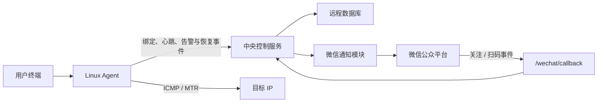
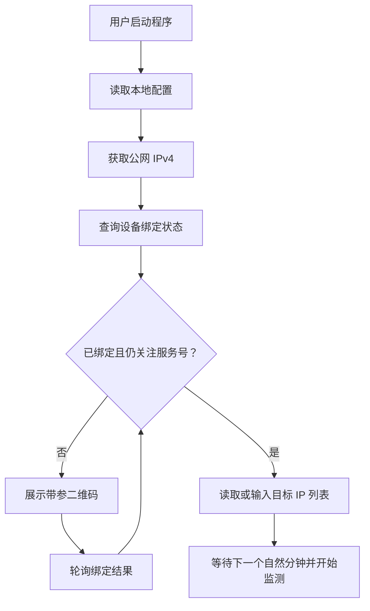
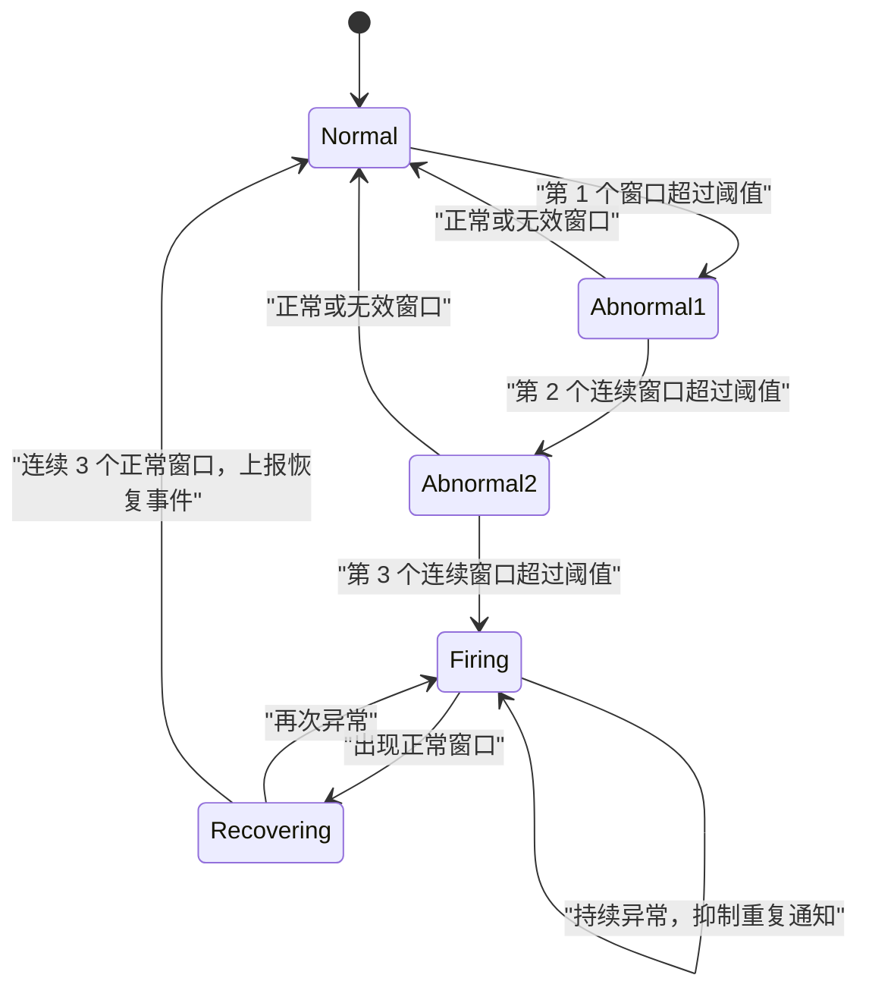

# 微信服务号网络质量监测系统设计文档

## 1. 项目概述

| 项目     | 内容                       |
| -------- | -------------------------- |
| 文档版本 | v0.2                       |
| 编制日期 | 2026-07-31                 |
| 技术栈   | Go Agent、FastAPI 中央服务 |
| 运行平台 | Linux                      |

本项目用于在用户自有 Linux 服务器上持续监测指定 IP 的网络质量。Agent 在每个自然分钟窗口内对所有目标 IP 并发执行 ICMP 探测，统计丢包率和平均延迟；同一目标 IP 连续 3 个窗口的丢包率超过阈值时自动执行 MTR，并通过微信服务号向绑定用户发送告警。

后续版本支持同一用户多设备之间的跨网探测和跨省探测。

### 1.1 项目目标

1. 通过微信服务号扫码完成用户与设备绑定。
2. 支持用户配置 ICMP 探测目标和丢包告警阈值。
3. 在每个自然分钟窗口内并发探测所有目标 IP。
4. 同一目标 IP 连续 3 个窗口超阈值时发送微信告警并自动执行 MTR。
5. 支持异常告警抑制、故障恢复判断和恢复通知。
6. 以 Linux 二进制和 `systemd` 服务方式持久部署。
7. 为多设备跨网、跨省探测预留扩展能力。

## 2. 关键设计决策

### 2.1 两层架构

系统分为中央控制服务和 Linux Agent：

- **中央服务**：负责微信回调、二维码生成、绑定管理、设备管理、告警与恢复事件接收和微信通知。
- **Linux Agent**：负责终端交互、公网 IP 获取、ICMP 探测、MTR，以及告警与恢复事件上报。

### 2.2 设备身份

- `device_id`：首次运行时随机生成，作为设备主键。
- `openid`：中央服务保存并由 Agent 本地缓存的微信用户标识。
- `public_ipv4`：设备当前网络属性，用于展示、ISP 和省份识别，以及跨网、跨省探测。

系统保留 `openid` 与公网 IP 的关联历史，设备识别以 `device_id` 为准。

### 2.3 告警机制

系统按目标 IP 独立维护连续异常计数。连续 3 个有效窗口的丢包率均超过阈值后才执行 MTR 并上报告警；正常或无效窗口会将尚未触发的连续异常计数清零。告警触发后由 Agent 在本地抑制重复上报，连续 3 个正常窗口后上报恢复事件并重新启用该目标的告警触发能力。

## 3. 总体架构



### 3.1 中央服务模块

| 模块                 | 职责                                             |
| -------------------- | ------------------------------------------------ |
| WeChat Client        | 管理`access_token`、二维码、关注状态和模板消息 |
| Binding Service      | 创建绑定会话并处理扫码事件                       |
| Device Service       | 管理设备、IP、ISP、省份和心跳                    |
| Alert Receiver       | 接收异常告警和故障恢复事件                       |
| Notification Service | 根据设备绑定关系向对应用户发送微信消息           |

### 3.2 Agent 模块

| 模块               | 职责                                       |
| ------------------ | ------------------------------------------ |
| CLI / Config       | 首次配置、模式选择和本地配置管理           |
| Public IP Resolver | 获取并校验公网 IPv4                        |
| Scheduler          | 对齐自然分钟并控制窗口期限                 |
| ICMP Engine        | 执行探测并计算结果                         |
| MTR Runner         | 安全执行 MTR 并解析结果                    |
| Control Client     | 绑定、心跳、告警与恢复事件上报             |
| Local Buffer       | 中央服务不可用时暂存待发送的告警与恢复事件 |

## 4. 核心流程

### 4.1 启动与绑定



绑定步骤如下：

1. Agent 生成或读取 `device_id`，请求 `https://api.ip.sb/ip` 获取公网 IPv4。
2. Agent 向中央服务查询设备绑定状态。
3. 未绑定时，中央服务按北京时间生成 `scene_str`，写入待绑定用户记录，并申请微信服务号带参二维码。
4. Agent 在终端展示二维码，并使用 `scene_str` 轮询对应用户记录的绑定结果。
5. 微信向 `/wechat/callback` 推送 `subscribe` 或 `SCAN` 事件。
6. 中央服务验签，根据场景值补全用户记录的 `openid`，并建立用户与 `device_id` 的关系。
7. Agent 获得 `openid` 后，将其写入本地配置。

`scene_str` 格式为北京时间 `YYMMDDHHMMSS` 加 4 位随机字母数字，总长度为 16 位。随机部分使用大写字母 `A-Z` 和数字 `0-9`，例如：`260731153045A7K2`。

微信二维码接口使用字符串场景类型 `QR_STR_SCENE`，并将该值放入 `scene_str`。二维码和服务端记录均在 5 分钟后失效，服务端依据 `created_at + 5 分钟` 校验有效期。

### 4.2 微信回调

- `GET /wechat/callback`：完成微信服务器配置验证。
- `POST /wechat/callback`：接收关注、扫码和取消关注事件。

回调必须验证签名、限制请求体大小、幂等处理重复事件，并快速返回。取消关注后应停止向该用户发送通知。

### 4.3 整分钟窗口探测

1. Agent 等待下一个 `HH:mm:00`，为窗口创建 50 秒的 Context，不补做已开始的分钟。
2. Agent 复用进程内共享 ICMP socket，为每个目标 IP 启动独立 goroutine，并在窗口开始时同时探测，不创建子进程、不分批执行。
3. 每个目标发送 100 个 ICMP Echo Request，发送间隔为 200ms，单包超时为 300ms；接收 goroutine 根据目标 IP、Identifier 和 Sequence 匹配响应。
4. 窗口结束后分别计算各目标的丢包率和成功响应平均延迟。
5. 同一目标连续 3 个窗口超阈值时执行 MTR 并上报告警；告警后连续 3 个正常窗口时上报恢复事件。

## 5. ICMP 探测设计

### 5.1 默认参数

| 参数           | 默认值                       |
| -------------- | ---------------------------- |
| 每目标探测次数 | 100                          |
| 发送间隔       | 200ms                        |
| 单包超时       | 300ms                        |
| 窗口期限       | 50s                          |
| 丢包阈值       | 用户手动输入确认，默认 0.05% |

### 5.2 统计规则

```text
loss_rate = (sent_count - received_count) / sent_count * 100
average_latency = sum(successful_rtt) / received_count
```

- 只统计合法且唯一的响应。
- 平均延迟只计算成功响应。
- 100% 丢包时平均延迟为 `null`，不是 0ms。
- 超时后到达的响应不计入当前窗口。

使用 `golang.org/x/net/icmp` 实现 ICMP 消息收发和响应匹配。

每个目标 IP 独立维护连续异常计数。只有有效窗口且丢包率严格大于阈值时才累计；正常窗口或无效窗口将未触发告警的计数清零。

## 6. MTR 与告警

### 6.1 MTR

同一目标 IP 连续 3 个有效窗口的丢包率均超过阈值时，Agent 执行报告模式 MTR：

- 目标必须先验证为合法 IP。
- 使用参数数组执行子进程，禁止拼接 shell 命令。
- 设置执行超时、输出大小和并发上限。
- 优先使用 JSON 等结构化输出。
- MTR 结果与异常窗口统计合并为一条异常告警上报中央服务。

### 6.2 告警状态



默认策略：

| 策略             | 建议值                               |
| ---------------- | ------------------------------------ |
| 告警触发条件     | 同一目标连续 3 个有效窗口超过阈值    |
| 首次触发操作     | 执行 MTR 并发送告警                  |
| 重复通知抑制     | 15 分钟                              |
| 持续故障重新 MTR | 30 分钟                              |
| 恢复条件         | 告警后连续 3 个正常窗口              |
| 恢复操作         | 上报恢复事件、发送恢复通知并重新布防 |

中央服务收到告警或恢复事件后，根据 `device_id` 查询 `devices.user_id` 和 `users.openid`，再调用服务号向对应用户发送消息。告警消息包含设备、目标 IP、连续 3 个异常窗口的丢包率和平均延迟，以及 MTR 结果摘要；恢复消息包含设备、目标 IP、恢复时间和连续 3 个正常窗口的统计。

## 7. 数据设计

### 7.1 `users`

| 字段                 | 数据类型         | 键         | 说明                                                   |
| -------------------- | ---------------- | ---------- | ------------------------------------------------------ |
| `id`               | `BIGINT`       | `PK`     | 用户内部主键，自增                                     |
| `openid`           | `VARCHAR(128)` | `UNIQUE` | 微信用户标识；扫码前允许为空，绑定完成后写入           |
| `scene_str`        | `VARCHAR(16)`  | `UNIQUE` | 字符串场景值，同时作为 Agent 轮询查询键                |
| `subscribe_status` | `INT`          | -          | 当前是否关注服务号；`0` 表示未订阅，`1` 表示已订阅 |
| `created_at`       | `BIGINT`       | -          | 创建时间，Unix 时间戳，单位秒                          |
| `updated_at`       | `BIGINT`       | -          | 更新时间，Unix 时间戳，单位秒                          |

创建二维码时先插入待绑定用户记录；微信回调根据 `scene_str` 查找该记录并写入 `openid`。Agent 轮询到 `openid` 非空、`subscribe_status` 有效且场景值未过期后，即认为用户验证完成。

### 7.2 `devices`

| 字段             | 数据类型        | 键                            | 说明                                                 |
| ---------------- | --------------- | ----------------------------- | ---------------------------------------------------- |
| `id`           | `BIGINT`      | `PK`, `AUTO_INCREMENT`    | 设备记录自增主键                                     |
| `device_id`    | `VARCHAR(64)` | `UNIQUE`                    | Agent 首次绑定时生成的稳定设备标识                   |
| `user_id`      | `BIGINT`      | `FK → users.id`, `INDEX` | 关联`users.id`；绑定前允许为空，关联用户删除后置空 |
| `public_ipv4`  | `VARCHAR(15)` | -                             | 设备当前公网 IPv4                                    |
| `isp`          | `INT`         | -                             | 当前公网 IP 对应的运营商编码                         |
| `province`     | `VARCHAR(32)` | -                             | 当前公网 IP 对应的归一化省份                         |
| `last_seen_at` | `BIGINT`      | -                             | 最后在线时间，Unix 时间戳，单位秒                    |
| `created_at`   | `BIGINT`      | -                             | 创建时间，Unix 时间戳，单位秒                        |
| `updated_at`   | `BIGINT`      | -                             | 更新时间，Unix 时间戳，单位秒                        |

绑定完成后，中央服务在同一事务中更新 `users` 的微信信息和 `devices.user_id`。同一 `openid` 已存在时应复用原用户记录，避免生成重复用户。

## 8. 本地用户配置

```yaml
device:
  device_id: "5b65a1c8-6f23-4e10-b0c9-58ccaa1acd87"
  public_ipv4: "203.0.113.10"

user:
  openid: "wechat-user-openid"

monitor:
  mode: "custom_icmp"
  targets: ["1.1.1.1", "8.8.8.8"]
  loss_threshold_percent: 0.5
```

`device` 仅保存 `device_id` 和 `public_ipv4`。本地 `openid` 用于启动时查询用户关注和设备绑定状态。

## 9. 跨网探测扩展

中央服务根据 `https://ip9.com.cn/get?ip={ip}` 返回的 `data.isp` 将运营商归一化为以下编码：

- `1`：电信
- `2`：移动
- `3`：联通
- `0`：其他运营商

跨网目标必须与当前设备属于同一用户、处于在线状态、拥有有效公网 IP、ISP 不同且明确启用跨网探测。

## 10. 跨省探测扩展

中央服务根据 `https://ip9.com.cn/get?ip={ip}` 返回的省份字段进行归一化。接口当前实际返回字段为 `data.prov`，同时兼容可能出现的 `data.province`。

跨省目标必须与当前设备属于同一用户、处于在线状态、拥有有效公网 IP、归一化省份不同且明确启用跨省探测。跨省目标筛选独立于 ISP 编码。

## 11. 部署方案

### 11.1 中央服务

中央服务接口使用 FastAPI 实现并部署在公网服务器。微信回调地址保持为 `http://<ip>/wechat/callback`，同时向 Agent 提供绑定、轮询、设备管理，以及告警与恢复事件接收能力。

### 11.2 Agent

Agent 编译为 Linux 二进制文件并部署到用户服务器。运行前需授予 ICMP 探测所需权限；启动时检查公网 IP 获取、中央服务连接、ICMP 和 MTR 能力，检查通过后进入持续监测。

## 12. 实施计划

| 阶段     | 主要内容                                               |
| -------- | ------------------------------------------------------ |
| 第一阶段 | 中央服务、微信绑定、自定义 IP 探测、异常告警和恢复通知 |
| 第二阶段 | MTR、告警抑制与恢复、本地缓存、`systemd` 和可观测性  |
| 第三阶段 | 多设备管理、ISP 编码、省份归一化、跨网探测和跨省探测   |
