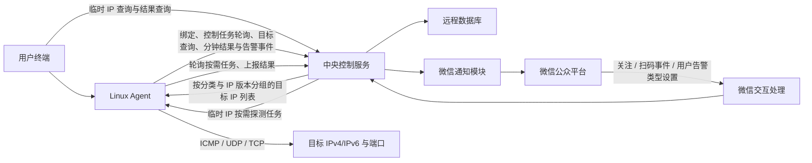
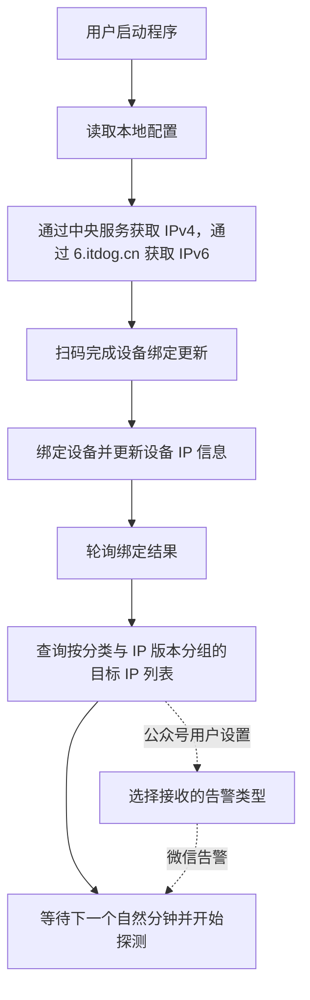
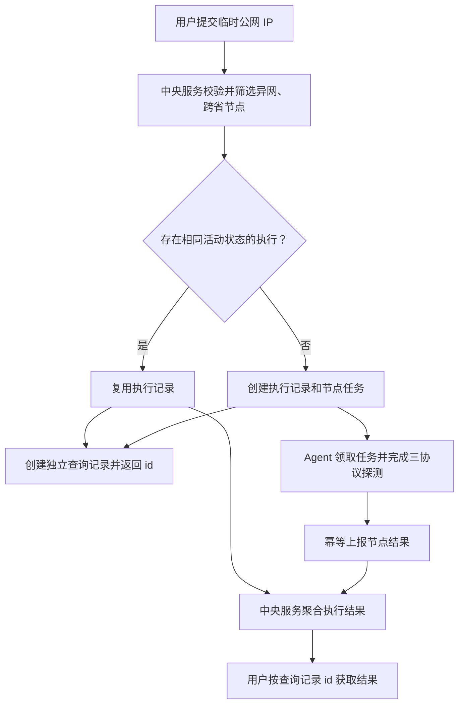

# 微信服务号网络质量探测系统设计文档

## 1. 项目概述

| 项目     | 内容                           |
| -------- | ------------------------------ |
| 文档版本 | v0.0.10                        |
| 更新日期 | 2026-08-05                     |
| 技术栈   | Golang Agent、FastAPI 中央服务 |
| 运行平台 | Linux                          |

本项目用于在用户自有 Linux 服务器上持续探测异网和跨省网络质量，并支持用户对临时公网 IP 发起类似 ITDog 的按需查询。设备绑定成功后，Agent 无需用户选择探测类型，也无需用户手动输入持续监控目标 IP；Agent 自动向中央服务查询当前设备对应的异网与跨省目标 IP 列表，在相同 IP 版本内对两个分类列表按 IP 去重合并，并在单个 Go 进程内对合并后的目标执行 ICMP、TCP 和 UDP 探测。IPv4 源地址只探测 IPv4 目标，IPv6 源地址只探测 IPv6 目标；同一 IP 同时属于异网和跨省时只执行一次实际网络探测。每个整分钟窗口结束时，Agent 按 `device_id + probe_mode + ip_version + source_ip` 分组上报三种协议的探测结果，各目标的 `target_ip` 和汇总结果保存在 `targets` 数组中；同一窗口内发生的丢包按目标、协议和分类聚合为告警批次上报。用户在微信服务号中选择接收异网告警、跨省告警或同时接收两类告警，中央服务按用户的告警类型设置发送通知。

临时 IP 查询不要求目标安装 Agent，也不将目标伪装成设备。中央服务识别临时 IP 的 ISP、省份和 IP 版本后，默认选择与目标异网或跨省、当前在线且允许作为公开探测节点的同版本 Agent。每个选中节点对指定临时 IP 的 ICMP、TCP 和 UDP 分别发送 10 次探测，10 次发送安排在 1 秒发送窗口内，完成后向中央服务返回汇总结果。两个用户在同一活动执行期间以相同参数查询同一 IP 时，各自保留独立查询记录，但可共享同一次实际节点探测。

### 1.1 项目目标

1. 通过微信服务号扫码完成用户与设备绑定。
2. 登录成功后由 Agent 自动查询当前设备按 IPv4/IPv6 分组的异网与跨省持续监控目标 IP 列表，不要求用户选择探测类型或输入持续监控目标 IP。
3. 对相同 IP 版本的异网和跨省列表按 IP 去重合并，并对合并后的每个唯一目标 IP 固定执行 ICMP、TCP 和 UDP 三种探测。
4. 每个整分钟窗口结束时，以 JSON 格式上报当前窗口的 Unix 时间戳、丢包率和平均延迟。
5. 每个自然分钟结束时聚合当前窗口的丢包告警，并按用户在微信服务号中设置的告警类型发送通知。
6. 以单个 Linux 二进制和 `systemd` 服务方式持久部署，探测过程不创建子进程。
7. 由中央服务一次查询并按探测分类和 IP 版本返回 ISP 不同或省份不同且处于公开状态的设备关联公网 IP。
8. 支持临时公网 IP 按需查询，自动选择当前异网与跨省在线探测节点，每个节点在 1 秒发送窗口内分别执行 10 次 ICMP、TCP 和 UDP 探测并返回结果。
9. 相同参数的并发临时 IP 查询复用实际探测任务，同时保持用户查询记录、访问权限和结果展示相互隔离。

## 2. 关键设计决策

### 2.1 两层架构

系统分为中央控制服务和 Linux Agent：

- **中央服务**：负责微信回调、二维码生成、绑定管理、设备管理、用户告警类型设置、持续探测结果与告警事件接收、微信通知，以及临时 IP 校验和归属识别、在线探测节点选择、按需任务合并、任务下发、结果聚合和查询权限控制。
- **Linux Agent**：负责终端交互、扫码绑定、异网与跨省目标查询、按需任务轮询、ICMP、UDP、TCP 探测，以及分钟探测结果、按需结果和丢包告警事件上报。

### 2.2 设备身份

- `device_id`：首次运行时随机生成 `UUID v4`，作为 Agent 使用的稳定设备标识。
- `openid`：仅由中央服务保存和使用，不返回给 Agent，也不写入本地配置。
- `device_related_id`：在 `ip_dict` 中可为空，中央服务在公网地址获取和绑定过程中识别设备的 IPv4/IPv6，并通过该字段将 IP 记录关联到 `devices.id`；空值表示 IP 记录尚未关联设备。在 `probe_state_icmp`、`probe_state_tcp`、`probe_state_udp` 和 `alert_events` 中为非空字段，用于记录实际上报结果或告警的设备。Agent 不在本地持久化该内部主键。
- `public_status`：存储在 `ip_dict` 中，控制该公网 IP 是否可被选为探测目标；`0` 表示未公开，`1` 表示公开。新 IP 默认值为 `1`，后续内部控制器关联的 IP 按 13.3 节设为 `0`。

对于已关联设备的 IP 记录，中央服务通过 `devices.id = ip_dict.device_related_id` 维护设备与多个公网 IP 的一对多关联；`device_related_id` 为空的记录不属于任何设备。Agent 和中央服务之间的设备识别只使用 `device_id`。后续增加基于 salt 的设备身份校验，具体方案见 13.2 节。

### 2.3 结果与告警上报

系统分别处理分钟探测结果和分钟聚合丢包告警。Agent 在每个整分钟窗口结束后，为每个结果或告警 HTTP 请求独立生成 `[0, 10s)` 的随机延迟，以窗口结束时间为基准异步发起上报，避免大量 Agent 在整分钟边界形成请求尖峰。结果按 `device_id + probe_mode + ip_version + source_ip` 分组，将同一组内各 `target_ip` 的 ICMP、TCP 和 UDP 汇总结果放入 `targets` 数组；同时按 `ip_version + probe_mode + source_ip + target_ip + protocol_type` 聚合当前窗口的丢包，每个聚合维度最多生成一条告警，所有告警通过一个 `alerts` 数组一次上报。随机延迟不改变请求中的窗口结束时间戳，也不阻塞下一窗口探测。`probe_mode` 仅表示目标所属的异网或跨省分类，不再表示用户在 Agent 中选择的运行模式。中央服务校验请求中的 `device_id` 后，将对应 `devices.id` 写入结果或事件的 `device_related_id`；发送告警时通过该字段关联设备用户，仅当用户仍关注且 `alert_type` 包含对应告警类型时发送微信消息。

### 2.4 持续探测与按需探测隔离

持续探测继续使用 `ip_dict` 中关联设备的公开 IP 作为目标，并按自然分钟保存结果和产生丢包告警。临时 IP 按需查询只使用查询、共享执行和节点任务三层模型；临时目标不要求关联 `devices.id`，不得写入 `ip_dict`，也不得因被查询而进入公开目标池。

按需查询中的用户查询记录与实际网络执行分离。每次用户请求都生成独立 `probe_queries.id`；中央服务对目标 IP、探测参数和探测节点集合完全一致且仍处于排队或执行状态的查询复用同一个 `on_demand_executions.id`。复用只减少重复网络报文，不合并用户身份、权限、配额和查询历史。

### 2.5 控制任务轮询与设备心跳

Agent 的控制任务长轮询同时作为设备心跳。中央服务在轮询请求通过设备身份校验后刷新 `devices.last_seen_at`，并根据统一离线阈值判断设备是否在线；即使当前没有任务或设备已关闭按需探测，Agent 也必须持续轮询，不再单独发送心跳请求。

## 3. 总体架构



### 3.1 中央服务模块

| 模块                 | 职责                                             |
| -------------------- | ------------------------------------------------ |
| WeChat Client        | 管理`access_token`、二维码、关注状态和模板消息 |
| Binding Service      | 创建绑定会话并处理扫码事件                       |
| Device Service       | 管理设备、设备与 IP 的一对多关系及在线状态       |
| IP Dictionary        | 管理 IP、IP 版本、ISP、省份、城市和公开状态      |
| Target Discovery     | 按网络属性和公开状态同时筛选异网与跨省目标       |
| On-demand Query      | 校验临时 IP、选择在线节点、合并查询和聚合结果    |
| Task Dispatcher      | 按设备原子分配按需任务并更新任务状态             |
| Result Receiver      | 接收并保存整分钟窗口探测结果                     |
| On-demand Receiver   | 幂等接收节点按需探测结果                         |
| Alert Receiver       | 接收分钟聚合丢包告警并按用户告警类型路由通知     |
| Notification Service | 根据设备绑定关系及用户告警类型发送微信消息       |

### 3.2 Agent 模块

| 模块           | 职责                                                         |
| -------------- | ------------------------------------------------------------ |
| CLI / Config   | 首次配置和本地设备配置管理                                   |
| Scheduler      | 对齐自然分钟、校验目标上限、按 IP 版本合并去重并控制分钟边界 |
| Task Poller    | 长轮询控制任务，并以轮询请求维持设备在线状态                 |
| Probe Engine   | 统一调度 ICMP、UDP 和 TCP Driver                             |
| Control Client | 绑定、目标查询、控制任务轮询、结果与告警事件上报             |
| Local Buffer   | 中央服务不可用时暂存待发送的分钟结果、按需结果与告警事件     |

## 4. 核心流程

### 4.1 启动与绑定



流程说明如下：

1. Agent 读取 `device_id` 后，通过中央服务获取当前设备的公网 IPv4，并通过 IPv6 连接请求 `6.itdog.cn` 获取公网 IPv6，随后暂存成功获取的地址。公网 IPv4 为启动必需项：获取失败时提示用户并阻塞重试，不进入扫码绑定；公网 IPv6 获取失败不阻塞后续流程。IPv4 获取成功后，每次启动均展示 5 分钟有效的带参二维码并轮询绑定结果。
2. 用户关注或扫码后，中央服务完成用户与设备绑定，并将 Agent 获取到的公网 IPv4 和 IPv6 写入 `ip_dict`，关联到对应设备并更新网络属性。新用户的 `alert_type` 默认为 `1`，已有用户保留原设置；Agent 仅接收绑定状态。
3. 绑定成功后，Agent 使用当前公网 IPv4 和已成功获取的公网 IPv6 查询目标。中央服务始终返回异网和跨省 IPv4 列表；仅当 `source_ipv6` 有效时返回异网和跨省 IPv6 列表。Agent 按相同 IP 版本配对后开始持续探测，不要求用户选择探测类型或告警类型。
4. 用户可在微信服务号中将 `alert_type` 设置为 `1`（仅异网）、`2`（仅跨省）或 `3`（两类告警）。该设置对用户绑定的全部设备生效，只控制微信通知，不影响探测。

二维码使用 `QR_STR_SCENE`。`scene_str` 由北京时间 `YYMMDDHHMMSS` 和 4 位随机大写字母或数字组成，例如 `260731153045A7K2`；二维码有效期为 5 分钟。创建二维码时不预写用户记录，微信回调取得有效 `openid` 后才创建或更新用户并保存 `scene_str`。

### 4.2 微信回调

- 微信服务器配置验证请求：完成签名校验并返回验证结果。
- 微信事件回调请求：接收关注、扫码和取消关注事件。

回调必须验证签名、限制请求体大小、幂等处理重复事件，并快速返回。取消关注后应停止向该用户发送通知。

用户可在微信服务号中修改自己的 `users.alert_type`；取消关注后保留该设置但停止通知，重新关注后恢复。

### 4.3 公开设备探测目标查询

Agent 提交 `device_id`、必填的 `source_ipv4`、可空的 `source_ipv6` 及设备身份校验字段，不提交用户选择的模式。中央服务校验非空源 IP 的版本和设备归属，在 `ip_dict` 中创建或复用记录，并刷新网络属性和 `update_time`。

中央服务分别以 IPv4、IPv6 源地址筛选同版本目标。候选 IP 必须合法、`public_status = 1`、不是当前源 IP，且不得属于当前设备；候选 IP 不要求关联设备，也不依赖设备在线状态或 IP 刷新时间。分类条件如下：

| 分类 | `probe_mode`     | 附加条件                                   |
| ---- | ------------------ | ------------------------------------------ |
| 异网 | `cross_isp`      | 源与目标的 ISP 均已识别且不同              |
| 跨省 | `cross_province` | 源与目标的省份均已识别、不是未知编码且不同 |

响应始终返回两个 IPv4 targets 列表；仅当 `source_ipv6` 有效时才返回两个 IPv6 targets 列表。若 Agent 未获取到 `source_ipv6`，请求和响应中的 `source_ipv6` 均为 `null`，响应省略 `cross_isp_ipv6_targets` 和 `cross_province_ipv6_targets`；Agent 将这两个字段缺失视为本轮无 IPv6 探测任务，不得视为响应格式错误。所有可用地址族的异网和跨省列表均为空时，中央服务拒绝本次查询，Agent 在终端提示“当前获取的异网和跨省探测目标为空”，不得进入空探测循环。响应仅包含探测所需的公开信息。以下为 IPv4、IPv6 均可用时的完整示例：

```json
{
  "source_ipv4": "198.51.100.10",
  "source_ipv6": "2001:db8:100::10",
  "cross_isp_ipv4_targets": [
    {
      "public_ip": "203.0.113.20",
      "isp": 2,
      "province": 12
    }
  ],
  "cross_province_ipv4_targets": [
    {
      "public_ip": "198.51.100.30",
      "isp": 1,
      "province": 31
    }
  ],
  "cross_isp_ipv6_targets": [
    {
      "public_ip": "2001:db8:200::20",
      "isp": 2,
      "province": 12
    }
  ],
  "cross_province_ipv6_targets": [
    {
      "public_ip": "2001:db8:300::30",
      "isp": 1,
      "province": 31
    }
  ]
}
```

- 列表名称唯一确定 IP 版本，目标项不返回 `ip_version`；Agent 必须校验 `public_ip` 的实际地址族，不匹配时拒绝调度。
- 各列表按 `device_id`、`ip_dict.id` 升序返回并按 `ip_dict.id` 去重；不得返回 `user_id`、`openid` 或告警设置。
- 同一 IP 可同时出现在同版本的两个分类列表中；Agent 保留其分类集合，合并后只探测一次，并将统计结果分别用于对应分类的结果和告警。

### 4.4 整分钟窗口探测

源地址、服务端返回列表与 Agent 实际探测列表的关系如下：

| 本机源地址 | 服务端返回的分类列表                                                                       | 实际探测的合并 IP 列表  |
| ---------- | ------------------------------------------------------------------------------------------ | ----------------------- |
| IPv4       | `cross_isp_ipv4_targets`、`cross_province_ipv4_targets`                                | `merged_ipv4_targets` |
| IPv6       | `cross_isp_ipv6_targets`、`cross_province_ipv6_targets`，仅 `source_ipv6` 有效时返回 | `merged_ipv6_targets` |

1. Agent 等待下一个 `HH:mm:00`，以该时刻到下一分钟 `HH:mm:00` 的完整 60 秒作为自然分钟窗口，并将 Context deadline 对齐窗口结束边界，不补做已开始的分钟。
2. Agent 刷新中央服务返回的两个 IPv4 目标列表，以及 `source_ipv6` 有效时返回的两个 IPv6 目标列表，并处理列表中的全部目标。
3. Agent 将两个 IPv4 列表中的 `public_ip` 解析为规范地址并合并去重，生成内部列表 `merged_ipv4_targets`；存在 IPv6 列表时以相同方式生成 `merged_ipv6_targets`。
4. Agent 严格按相同 IP 版本执行探测：本机 IPv4 只探测 `merged_ipv4_targets`，本机 IPv6 只探测 `merged_ipv6_targets`。IPv6 不可用时不创建 `merged_ipv6_targets`。
5. Agent 为合并列表中的每个唯一 IP 固定生成 ICMP、TCP 和 UDP 三个逻辑目标，并为每个逻辑目标启动独立 goroutine，在窗口开始时同时探测，不创建子进程、不分批执行。同一 IP 同时属于两个分类时不得重复创建 Driver 探测任务。ICMP Driver 按 IP 版本复用绑定通配地址的共享 socket，UDP 和 TCP Driver 不指定本地地址，由系统路由选择实际出口接口和地址。
6. 每个逻辑目标在每个自然分钟窗口内固定执行 100 次探测。发送间隔由 `probe_interval = window_duration / probe_count` 计算；窗口固定为 60 秒，因此发送间隔为 `60s / 100 = 600ms`。
7. 第 `i` 次探测的计划发送时刻为 `window_start + i * probe_interval`，其中 `i` 从 0 到 99。Scheduler 使用基于窗口起点的绝对计划时刻，避免单次探测耗时造成累计漂移；最后一次发送时刻为窗口开始后的 59.4 秒。
8. 各 Driver 按协议语义匹配响应并生成统一结果；单次探测判定为丢包时仅累计到当前逻辑目标统计，不立即发起告警请求。
9. 窗口结束后分别计算各唯一目标三种协议的丢包率和成功响应平均延迟，在终端输出本窗口结果，再按目标的所属分类将同一份统计结果投影到对应 `probe_mode`，并以 `device_id + probe_mode + ip_version + source_ip` 分组写入 `targets` 数组后上报。仅为至少包含一个目标的分类生成结果上报；发生丢包的目标按 IP 版本、分类和协议生成分钟告警，所有分钟告警通过单个批次请求上报。

### 4.5 临时 IP 按需查询

临时 IP 查询用于用户主动输入单个公网 IPv4 或 IPv6，并从当前异网、跨省在线探测节点快速获取网络质量结果。临时目标只是本次查询的目标地址，不需要安装 Agent，也不分配 `device_id`。



#### 4.5.1 创建查询与选择节点

1. 中央服务校验用户和配额，将输入解析为规范公网 IP，并识别 IP 版本、ISP 和省份。
2. 中央服务选择全部同版本、最近 8 秒内在线、IP 有效且允许按需探测的节点。异网要求 ISP 不同，跨省要求省份不同。同一设备只选择最新的一条同版本源 IP，同时属于两个分类时合并为一个节点任务；若目标已属于某设备，则排除该设备。
3. 每个请求都创建独立 `probe_queries.id`。中央服务根据目标IP生成 `active_key`；相同 `active_key` 的执行仍在排队或执行时复用其 `on_demand_executions.id`，否则创建新执行及节点任务。
4. 复用执行时只新增关联该执行的查询记录，不新增节点任务或重复探测；各查询共享当前进度和最终结果，但分别校验用户权限。执行进入终态后不再复用，后续查询重新创建执行。

#### 4.5.2 Agent 执行

1. Agent 使用 `device_id` 长轮询本设备任务；轮询通过设备身份校验后，中央服务刷新 `devices.last_seen_at`。无任务或 `on_demand_status = 0` 时返回空任务，Agent 仍须继续轮询。中央服务以 `id + probe_device_id + status = 1` 为条件将节点任务原子更新为执行中并返回任务；更新失败表示任务已被其他请求获取。节点任务一旦进入执行中便不再重新下发。Agent 获取任务后为其创建独立 goroutine 和 Context，并立即继续轮询，同一节点可以并发执行来自不同执行记录的节点任务。
2. Agent 校验固定参数后并行执行 ICMP、TCP 80 和 UDP 33434，每个协议 10 次。发送时刻为 0ms 至 900ms、间隔 100ms，单次超时 300ms，最晚等待到约 1.2 秒。
3. Agent 按协议计算整数千分比 `loss_rate` 和整数毫秒 `average_latency_ms` 后幂等上报；失败时按 1 秒间隔有限重试，最多尝试 3 次。同一节点的两个分类共享结果；按需探测不产生分钟聚合丢包告警，也不受 `users.alert_type` 控制。

#### 4.5.3 聚合与返回

中央服务原子保存每个节点的完整上报。用户通过查询记录 `id` 轮询；执行未终态时也立即返回已完成节点，不等待其他节点。

顶层 `results` 固定包含 `cross_isp_results` 和 `cross_province_results`，只投影已完成节点。每项使用 `source_ip_id` 标识节点源 IP 记录，不返回 IP 字面量；协议结果仅返回 `loss_rate` 和 `average_latency_ms`。同一节点属于两类时投影到两个数组，但只探测和存储一次。其他节点仅计入状态数量。

非终态响应示例如下：

```json
{
  "execution_id": 1001,
  "status": "running",
  "target_ip": "203.0.113.20",
  "total_node_count": 3,
  "pending_node_count": 0,
  "running_node_count": 2,
  "completed_node_count": 1,
  "timeout_node_count": 0,
  "failed_node_count": 0,
  "results": {
    "cross_isp_results": [
      {
        "source_ip_id": 201,
        "isp": 1,
        "province": 31,
        "icmp": {
          "loss_rate": 100,
          "average_latency_ms": 19
        },
        "tcp": {
          "loss_rate": 0,
          "average_latency_ms": 25
        },
        "udp": {
          "loss_rate": 200,
          "average_latency_ms": 22
        }
      }
    ],
    "cross_province_results": [
      {
        "source_ip_id": 201,
        "isp": 1,
        "province": 31,
        "icmp": {
          "loss_rate": 100,
          "average_latency_ms": 19
        },
        "tcp": {
          "loss_rate": 0,
          "average_latency_ms": 25
        },
        "udp": {
          "loss_rate": 200,
          "average_latency_ms": 22
        }
      }
    ]
  }
}
```

全部任务终态或达到 15 秒截止时间后，顶层 `status` 为 `completed`、`partial_completed` 或 `failed`。

## 5. 统一探测模型

### 5.1 逻辑目标

每个实际探测目标使用稳定且唯一的 `target_id` 标识。Agent 根据 `ip_version`、`source_ip`、规范化后的目标 IP、协议和端口生成 `target_id`，`probe_mode` 不参与实际探测目标 ID 的生成；同一源目标组合同时属于异网和跨省时必须复用同一个 ID。目标由 IP 版本、源地址、目标地址、协议和端口共同定义，且源地址与目标地址的 IP 版本必须一致。每个合并后的唯一目标 IP 固定生成 ICMP、TCP 和 UDP 三个逻辑目标，各自独立统计；目标的所属分类集合只用于结果分组和告警事件生成。

按需探测复用相同的 Driver，但其逻辑目标 ID 额外包含节点任务 `id`，避免与同一 Agent 正在执行的持续探测或其他参数不同的按需执行发生统计和响应匹配冲突。同一节点任务同时属于两个分类时仍只生成三种协议各一个逻辑目标。

| 协议 | 固定端口   | 成功条件                                                  | 延迟含义     |
| ---- | ---------- | --------------------------------------------------------- | ------------ |
| ICMP | 不使用端口 | 收到匹配的 ICMP/ICMPv6 Echo Reply                         | ICMP RTT     |
| TCP  | `80`     | TCP connect 成功，或收到 connection refused               | TCP 响应 RTT |
| UDP  | `33434`  | 收到目标 UDP 回复，或收到目标返回的 ICMP Port Unreachable | UDP 往返时间 |

TCP 固定探测端口 80。TCP connect 成功和 connection refused 均证明目标网络可达，二者都计为成功响应并纳入平均延迟；只有 TCP timeout、无响应或其他无法证明目标可达的错误才计为丢包。UDP 固定探测端口 33434，直接向目标 IP 和端口发送带匹配标识的 datagram，不发送 DNS 请求。目标端口开放但应用不回复、目标防火墙静默丢弃和网络丢包均可能表现为超时，因此 UDP timeout 计入丢包率时必须保留该语义限制。

### 5.2 默认参数

#### 5.2.1 持续探测参数

| 参数                 | 默认值                |
| -------------------- | --------------------- |
| 每目标每窗口探测次数 | 固定 100              |
| 发送间隔             | 60s / 100，固定 600ms |
| 单次探测超时         | 300ms                 |
| 自然分钟窗口         | 固定 60s              |
| 探测目标分类         | 自动执行异网和跨省    |
| 探测协议             | 固定 ICMP、TCP、UDP   |

#### 5.2.2 临时 IP 按需探测参数

| 参数                     | 默认值                         |
| ------------------------ | ------------------------------ |
| 每节点每协议探测次数     | 固定 10                        |
| 发送窗口                 | 固定 1s                        |
| 发送间隔                 | 1s / 10，固定 100ms            |
| 单次探测超时             | 300ms                          |
| 探测节点分类             | 自动选择异网和跨省在线公开节点 |
| 探测协议                 | 固定 ICMP、TCP 80、UDP 33434   |
| 按需执行服务端总截止时间 | 默认 15s                       |

### 5.3 统一统计规则

```text
loss_rate = (attempted_count - successful_count) / attempted_count * 1000
average_latency_ms = round(sum(successful_rtt_ms) / successful_count)
```

- 有效窗口必须完成 100 次探测，只统计超时前收到的合法且唯一响应。
- `loss_rate` 使用 0 至 1000 的整数千分比；例如 1% 丢包为 `10`，10% 丢包为 `100`，100% 丢包为 `1000`。
- `average_latency_ms` 使用四舍五入后的整数毫秒，最大值为 `300ms`。
- 平均延迟仅计算成功响应并封顶为 `300ms`；100% 丢包时没有成功 RTT 样本，统一使用 `300ms`，不得返回 `null`。该值在 `loss_rate = 1000` 时是丢包占位值，不代表真实 RTT。
- 各协议按统一成功条件分类；TCP connected 和 TCP refused 均计入成功。

### 5.4 协议 Driver

- **ICMP Driver**：使用 `golang.org/x/net/icmp` 收发 ICMPv4/ICMPv6 消息，按 IP 版本共享 socket 和接收 goroutine，将 socket 绑定到逻辑目标的 `source_ip`，并根据源 IP、目标 IP、Identifier 和 Sequence 匹配 Echo Reply。
- **TCP Driver**：使用与 `ip_version` 对应的 `net.Dialer`，通过 `LocalAddr` 绑定 `source_ip` 后建立 TCP 连接，连接成功后立即关闭；connection refused 表示主机可达但端口未开放，应按成功探测记录 RTT 并单独分类，不计入丢包率，也不产生丢包告警。TCP timeout 或无法证明目标可达的错误计为丢包。
- **UDP Driver**：使用与 `ip_version` 对应的 socket 并绑定 `source_ip`，直接向相同 IP 版本的目标地址和端口发送带匹配标识的 datagram，为每个未决探测分配可回收的唯一 source port，并根据五元组、payload 标识及 ICMP 引用的原始 UDP header 匹配目标 UDP 回复或 ICMP/ICMPv6 Port Unreachable；单纯成功发送 datagram 不视为探测成功。

各 Driver 只负责协议收发与单次结果分类。窗口调度、并发启动、统计汇总、结果上报和丢包告警由统一 Probe Engine 管理，避免为不同协议重复实现调度与上报逻辑。

## 6. 探测结果上报与告警

### 6.1 整分钟探测结果上报

每个整分钟窗口结束时，Agent 按 `device_id + probe_mode + ip_version + source_ip` 生成上报请求，并使用 `unix_timestamp` 标识窗口结束时间。同一分类、IP 版本和源 IP 下的全部目标汇总结果保存在 `targets` 数组中；`targets` 至少包含一个目标，空分类不生成上报。中央服务校验 `source_ip` 属于 `device_id`，并校验 `targets` 中每个目标均已登记、与源 IP 的版本相同且等于顶层 `ip_version`。

```json
{
  "device_id": "source-device-id",
  "probe_mode": "cross_isp",
  "ip_version": 4,
  "source_ip": "198.51.100.10",
  "unix_timestamp": 1785542460,
  "targets": [
    {
      "target_ip": "203.0.113.20",
      "icmp": {
        "loss_rate": 10,
        "average_latency_ms": 19
      },
      "tcp": {
        "loss_rate": 0,
        "average_latency_ms": 25
      },
      "udp": {
        "loss_rate": 20,
        "average_latency_ms": 22
      }
    }
  ]
}
```

中央服务以 `device_id + probe_mode + ip_version + source_ip + unix_timestamp` 作为上报幂等键，并以首次完整持久化的请求内容为准。中央服务根据 `device_id + source_ip` 查询设备及源 IP 归属，再遍历 `targets`，根据全局唯一的 `target_ip` 查询目标 IP 记录，并校验目标不属于当前设备、源目标版本均等于请求中的 `ip_version`，以及目标符合对应分类和公开状态；目标本身不要求关联设备。任一目标校验失败时拒绝整份上报。校验通过后，各目标结果按协议分别写入 `probe_state_icmp`、`probe_state_tcp` 和 `probe_state_udp`，每条记录的 `device_related_id` 保存本次上报设备的 `devices.id`；相同幂等键的重试通过比较三张状态表中的已有设备关联及探测结果处理。

### 6.2 分钟聚合丢包告警

任一协议在自然分钟内至少一次探测未满足成功条件时，Agent 在窗口结束后按目标的所属分类分别生成分钟告警。同一 IP 同时属于异网和跨省时，分别生成一条 `cross_isp` 和一条 `cross_province` 告警，但不得重复执行网络探测；同一窗口、目标、协议和分类无论丢包多少次都只生成一条事件。TCP connection refused 仍按成功处理，不触发告警。当前窗口的全部事件封装在一个 `alerts` 数组中一次上报；没有丢包时不发起告警请求。

```json
{
  "alerts": [
    {
      "event_id": "018f6c2e-7c45-7a9b-9ca1-2bd56f5d9310",
      "device_id": "source-device-id",
      "probe_mode": "cross_isp",
      "ip_version": 4,
      "source_ip": "198.51.100.10",
      "target_ip": "203.0.113.20",
      "protocol_type": "icmp",
      "loss_rate": 100,
      "unix_timestamp": 1785542460
    }
  ]
}
```

`event_id` 作为单条分钟告警的幂等键，`unix_timestamp` 使用自然分钟窗口结束时刻，`loss_rate` 使用当前窗口对应目标和协议的 0 至 1000 整数千分比。中央服务在同一事务内逐条校验 `source_ip` 属于 `device_id`，根据全局唯一的 `target_ip` 查询目标 IP 记录，并校验目标不属于当前设备、IP 版本均与 `ip_version` 一致后，将当前设备的 `devices.id` 写入 `alert_events.device_related_id`，再保存整个告警批次。目标 IP 不要求关联设备。发送服务号模板消息时，中央服务直接通过事件的 `device_related_id` 查询设备关联用户及其 `openid`；用户仍关注服务号时，异网事件仅向 `alert_type` 为 `1` 或 `3` 的用户通知，跨省事件仅向 `alert_type` 为 `2` 或 `3` 的用户通知，不匹配的事件仅保存。

### 6.3 临时 IP 按需结果上报

Agent 完成一个节点任务后，以节点任务 `id` 作为幂等键上报三种协议结果，并在失败时有限重试。API 使用 `task_id` 表示该字段，当前请求同时携带 `device_id`，示例如下：

```json
{
  "task_id": 10241,
  "device_id": "probe-node-device-id",
  "source_ip": "198.51.100.10",
  "target_ip": "203.0.113.20",
  "started_at": 1785542412,
  "finished_at": 1785542414,
  "results": {
    "icmp": {
      "loss_rate": 100,
      "average_latency_ms": 19
    },
    "tcp": {
      "loss_rate": 0,
      "average_latency_ms": 25
    },
    "udp": {
      "loss_rate": 200,
      "average_latency_ms": 22
    }
  }
}
```

中央服务必须校验 `device_id`、任务归属和任务当前为执行中，确认上报的 `source_ip` 等于任务 `source_ip_id` 关联的 `ip_dict.ip` 且该 IP 仍属于执行设备，并确认 `target_ip` 等于执行记录中的目标 IP；同时校验 IP 版本和固定协议。每个协议的 `loss_rate` 必须是 0 至 1000 的整数千分比，`average_latency_ms` 必须是整数。首次完整持久化后，相同节点任务 `id` 和相同内容的重试返回成功；相同幂等键但内容不同的请求拒绝并记录审计信息。达到 15 秒总截止时间且尚未完整上报的任务直接标记为超时，不再重新下发，超时后到达的结果拒绝写入。

## 7. 数据设计

数据库表结构、字段定义、约束、索引及数据编码规则统一维护在 [数据库设计文档](./database_schema_design.md) 中，本节不再重复描述。

## 8. Agent 本地配置

```yaml
device:
  device_id: "5b65a1c8-6f23-4e10-b0c9-58ccaa1acd87"
```

本地配置暂时只保存 `device_id`，不包含 `monitor` 或告警类型配置块。Agent 每次启动并确认登录状态后自动获取两个 IPv4 目标列表；`source_ipv6` 有效时额外获取两个 IPv6 目标列表。Agent 将同版本的异网和跨省列表按规范化 IP 去重合并，本机 IPv4 只探测合并后的 IPv4 列表，本机 IPv6 只探测合并后的 IPv6 列表。合并后的每个唯一目标 IP 固定执行 ICMP、TCP 80 和 UDP 33434 三种探测。用户的告警类型设置只保存在中央服务，不下发或持久化到 Agent。

按需任务不写入本地配置。Agent 当前只使用相同的 `device_id` 轮询任务，不携带或持久化 `device_signature`；Agent 在内存中按节点任务 `id` 分别保存执行状态，并复用现有 Probe Engine 与三种协议 Driver。Agent 不配置按需任务并发数量，也不因已有任务正在执行而停止轮询；不同节点任务使用独立 goroutine、Context 和统计对象并发执行。持续分钟探测仍具有更高调度优先级，按需任务不得推迟自然分钟窗口；执行超过总截止时间时中央服务将节点任务标记为超时。

## 9. 异网探测告警

中央服务在设备绑定或刷新源地址时，分别查询公网 IPv4 和 IPv6 的 IP 归属信息，从匹配记录中提取运营商并写入对应 IP 记录的 `ip_dict.isp`：`1` 为电信、`2` 为移动、`3` 为联通、`4` 为其他。

Agent 查询目标时，中央服务为当前公网 IPv4 生成 `cross_isp_ipv4_targets`，并仅在 `source_ipv6` 有效时生成 `cross_isp_ipv6_targets`。每个列表只选择 `ip_dict.public_status = 1`、具有有效同版本公网 IP、不是当前源 IP 或当前设备其他 IP，且 `ip_dict.isp` 与对应源 IP 不同的记录。候选目标不要求关联设备；公开状态只授权将该公网 IP 用于探测，不授权返回设备绑定用户信息。运营商编码 `4` 表示其他运营商，只要与对应源 IP 的编码不同即可入选。Agent 无论用户的 `alert_type` 是否包含异网告警都执行可用地址族的异网列表探测；只有 `alert_type` 为 `1` 或 `3` 时才向该用户发送异网告警。

## 10. 跨省探测告警

中央服务将匹配记录的“省份-城市”字段拆分：省份归一化后写入 `ip_dict.province`（未知为 `1`），城市名称写入 `ip_dict.city`。

Agent 查询目标时，中央服务为当前公网 IPv4 生成 `cross_province_ipv4_targets`，并仅在 `source_ipv6` 有效时生成 `cross_province_ipv6_targets`。每个列表只选择 `ip_dict.public_status = 1`、具有有效同版本公网 IP、不是当前源 IP 或当前设备其他 IP，且 `ip_dict.province` 与对应源 IP 不同的记录。对应源 IP 和候选 IP 的省份均必须已明确识别，未知省份不得参与跨省探测；ISP 是否相同不影响跨省分类的筛选结果。候选目标不要求关联设备，城市仅用于展示和后续同省跨城市筛选。Agent 无论用户的 `alert_type` 是否包含跨省告警都执行可用地址族的跨省列表探测；只有 `alert_type` 为 `2` 或 `3` 时才向该用户发送跨省告警。

## 11. 部署方案

### 11.1 中央服务

中央服务使用 FastAPI 实现并部署在公网服务器，对外提供微信回调、绑定、轮询、设备管理、异网与跨省目标查询、分钟探测结果接收、丢包告警事件接收、临时 IP 查询、按需任务轮询、按需结果接收和用户结果查询能力。具体 HTTP 路径和方法由实现阶段统一定义，不在本设计文档中固定。

### 11.2 Agent

Agent 编译为单个 Linux 二进制文件并部署到用户服务器，运行期间不创建探测子进程。运行前需授予 ICMP 探测和 UDP 错误接收所需的 ICMPv4/ICMPv6 socket 权限；启动时检查中央服务连接、服务端设备网络属性识别状态、ICMPv4/ICMPv6 socket、UDP 和 TCP 能力，检查通过后进入持续探测。

## 12. 实施计划

各阶段按依赖顺序实施，当前阶段通过验收后再进入下一阶段，避免同时扩展探测协议、设备管理和任务编排。

| 阶段     | 主要内容                                                                                                  |
| -------- | --------------------------------------------------------------------------------------------------------- |
| 第一阶段 | 基础服务与设备绑定：FastAPI、数据库迁移、微信回调、二维码绑定、设备身份及公网 IP 属性管理                 |
| 第二阶段 | 身份校验与目标发现：salt 签发与校验、IP 公开状态、ISP/省份识别、异网与跨省目标查询                        |
| 第三阶段 | 网络探测闭环：IPv4/IPv6 四组目标自动查询、同地址族分钟调度、ICMP/TCP/UDP 并发探测、结果上报和分钟聚合丢包告警 |
| 第四阶段 | 生产可靠性：双栈异常处理、UDP 直连探测、Local Buffer、幂等重试、`systemd` 和可观测性                    |
| 第五阶段 | 多设备管理：公众号设备列表、用户告警类型设置、控制任务轮询心跳、在线/离线判定、公开状态管理和城市属性     |
| 第六阶段 | 临时 IP 按需查询：公网地址校验、在线节点筛选、并发查询合并、任务轮询、1 秒快速探测、结果聚合和访问控制    |
| 第七阶段 | 双向 MTR：双向任务编排、租约控制、Golang Agent 原生 MTR、结果聚合与路径展示                               |

## 13. 后续功能支持

### 13.1 双向 MTR

#### 13.1.1 功能目标与边界

后续版本支持用户在中央服务选择两个在线设备，并为每个设备选择一条当前有效的公网 IP。两个设备上的 Golang Agent 分别执行 `设备 A 的 IP -> 设备 B 的 IP` 和 `设备 B 的 IP -> 设备 A 的 IP` 的 MTR，并将逐跳结果上报中央服务。两个方向使用同一个 `mtr_task_id` 关联，单方向失败时仍保留另一方向的成功结果。

#### 13.1.2 总体流程

1. 中央服务接收设备 A、设备 B 及各自选定的 `ip_dict.id`，校验两个设备已绑定、当前心跳在线、IP 归属匹配、处于公开状态且仍在有效期内。
2. 中央服务创建一个双向 MTR 主任务，并基于创建时的两个 IP ID 和二进制地址快照生成 `A_TO_B` 和 `B_TO_A` 两个方向任务。
3. Agent 通过现有 Control Client 主动轮询本设备待执行任务。中央服务不主动连接 Agent，以适配 NAT、防火墙和仅允许出站连接的部署环境。
4. 两个 Agent 分别执行本方向的 MTR，并幂等上报结果。
5. 中央服务聚合两个方向的状态和逐跳结果，供用户查询。

#### 13.1.3 执行与上报

中央服务通过方向租约避免任务重复执行，并保存两个方向的设备 ID、IP ID 和地址快照；任务开始前任一 IP 的设备归属、公开状态或有效期已变化时停止下发并将任务标记为过期。

Golang Agent 在进程内复用现有探测能力执行 ICMP MTR，不调用外部命令。目标仅允许中央服务下发的 IP 字面量。

Agent 以结构化 JSON 上报任务、方向、设备、IP、执行时间、逐跳统计和错误码。中央服务校验租约、方向及 IP 快照，以 `mtr_task_id + direction` 作为幂等键，并分别展示两个方向的路径。

### 13.2 基于 salt 校验 `device_id`

#### 13.2.1 校验方案

中央服务内置仅服务端可读取的 `DEVICE_ID_SALT`。设备绑定成功后，中央服务计算 `device_signature = HMAC-SHA256(DEVICE_ID_SALT, device_id)` 并返回给 Agent；Agent 将签名与 `device_id` 一同保存在本地配置中。

本节方案暂不启用，当前接口只提交 `device_id`，不携带 `device_signature`。未来启用后，目标查询、控制任务轮询和结果上报、持续探测结果上报、告警上报及 MTR 请求再同时提交 `device_id` 与 `device_signature`；中央服务使用相同算法重新计算签名并进行常量时间比较，校验失败时拒绝请求。`device_id` 仍然只是设备标识，`device_signature` 才是设备持有中央服务签发凭据的证明。

### 13.3 内部控制器设备非公开处理

初期所有新建 IP 记录均使用 `ip_dict.public_status = 1`。后续中央服务识别出内部控制器设备后，将该设备关联的全部 `ip_dict.public_status` 强制设为 `0`；这些 IP 不得被异网、跨省或双向 MTR 的目标查询返回。普通 Agent 关联的 IP 继续使用默认公开状态，并允许用户通过多设备管理功能分别修改每条 IP 的公开状态。
